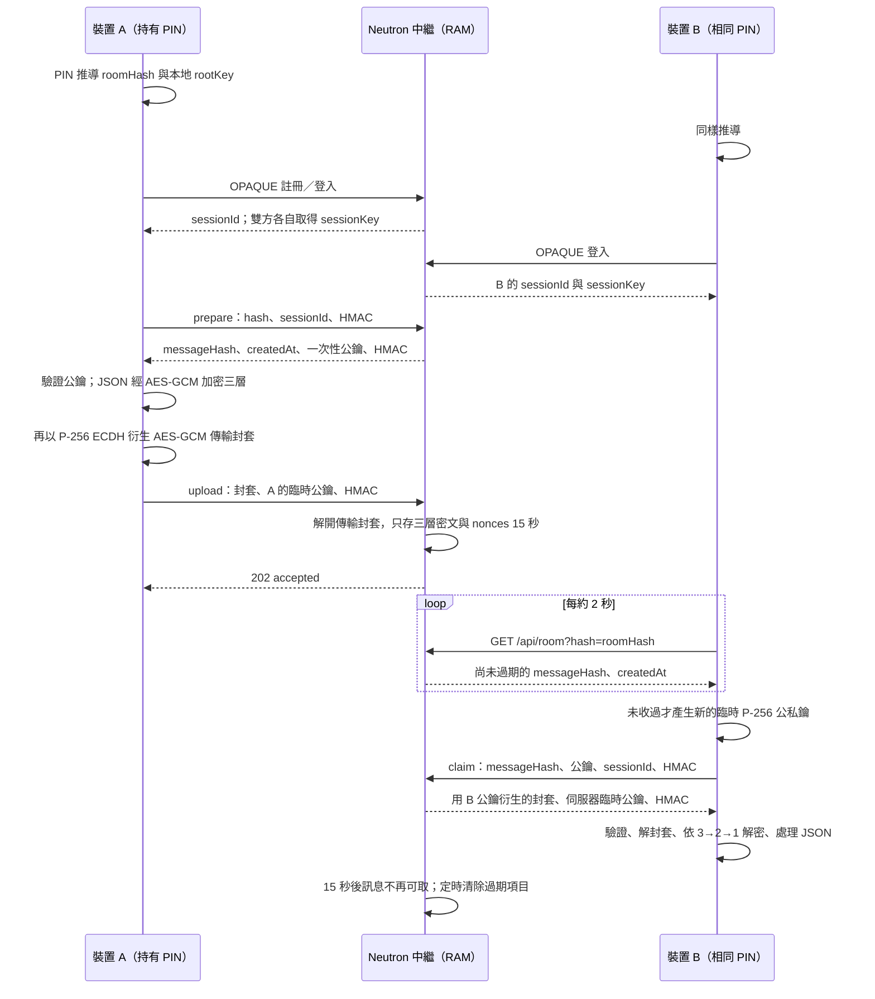

# 接上 Neutron 訊息迴路

Neutron 是一個短暫、加密的訊息中繼服務。兩個程式使用相同 PIN，便能加入相同房間，交換自行定義的 JSON。不需要在兩端開放入站連接埠；兩端都主動連向 `https://neutron.nxlabtw.com`。

這是 HTTP 輪詢訊息通道，不是 TCP、UDP、VPN 或可靠佇列。你仍使用 Neutron 伺服器；HTTPS 連線的來源 IP 對伺服器、代管商或代理可能可見。房內其他用戶不會由訊息 API 得到你的 IP，但這不等於網路匿名。

## 快速開始：兩個瀏覽器互傳 JSON

從 HTTPS 網頁或 localhost 執行以下模組；不要直接用 `file://` 開啟。兩端必須填入同一個高熵 PIN。範例中的固定 PIN 只用於測試，不適合真正的私密通訊。

```html
<script type="module" src="/neutron-example.js"></script>
```

把以下內容放入自己網站的 `neutron-example.js`。範例只啟動接收；由自己的按鈕呼叫 `sendJson`，避免每次重試都重複發送。

```js
import {
  deriveRoom, authenticateRoom, existingLogin, sendMessage, claimMessage
} from "https://neutron.nxlabtw.com/scripts/crypto.js";

const origin = "https://neutron.nxlabtw.com";
const room = await deriveRoom("replace-with-a-long-random-shared-PIN");
await authenticateRoom(room);
const seen = new Set();
let stopped = false;

async function ensureSession() {
  if (Date.now() >= room.sessionExpiresAt) await existingLogin(room);
}

// 綁到自己頁面的按鈕；真正的專案可用匯出函式代替 window。
window.sendJson = async (data) => {
  await ensureSession();
  const applicationId = crypto.randomUUID();
  await sendMessage(room, {
    app: "my-project", type: "event", applicationId, data
  });
  return applicationId;
};

async function poll() {
  await ensureSession();
  const response = await fetch(
    `${origin}/api/room?hash=${encodeURIComponent(room.roomHash)}`,
    { credentials: "omit", cache: "no-store" }
  );
  if (!response.ok) throw new Error(`List failed: ${response.status}`);
  const { messages } = await response.json();
  for (const descriptor of messages) {
    if (seen.has(descriptor.messageHash)) continue;
    let payload;
    try {
      payload = await claimMessage(room, descriptor);
    } catch (error) {
      if (error.message === "session_expired") {
        await existingLogin(room);
        break; // 下一次輪詢再領取，沒有先標記為已收。
      }
      if (error.message === "claim_failed") continue; // 可能已過期。
      throw error;
    }
    if (!payload) continue;
    seen.add(descriptor.messageHash);
    if (payload.app !== "my-project") continue;
    // 自己的訊息也可能收到。需要時以 applicationId 去重或忽略。
    // 在這裡驗證 type、data 的 schema，再交給自己的程式處理。
    document.dispatchEvent(new CustomEvent("neutron-message", { detail: payload }));
  }
}

async function receiveLoop() {
  while (!stopped) {
    try { await poll(); }
    catch { /* 可在自己的 UI 顯示連線狀態，下一輪繼續重試。 */ }
    if (!stopped) await new Promise(resolve => setTimeout(resolve, 2000));
  }
}
addEventListener("pagehide", () => { stopped = true; }, { once: true });
receiveLoop();
```

接收迴路採逐次等待，不讓慢請求重疊。正式專案也應限制 `seen` 大小、驗證資料結構，並處理身分識別、應用層 ACK、逾時和重送。`sendMessage` 回傳伺服器接受訊息，不表示另一端已收到。不要把收到的文字當成 HTML 或可執行程式。

目前匯出的模組是瀏覽器模組，使用 Web Crypto、WASM、`window` 和 `fetch`，不是 Python 標準函式庫或 Node.js 套件。其他語言須實作下述完全相容的協定，並使用相容的 OPAQUE 與密碼學套件；只有 HTTP 請求還不足以加入。

## 瀏覽器跨來源設定

Neutron 在 `/api`、`/api/*`、`/scripts/crypto.js`、`/scripts/crypto-core.mjs`、`/vendor/opaque/*` 回傳：

```http
Access-Control-Allow-Origin: *
Access-Control-Allow-Methods: GET, HEAD, POST, OPTIONS
Access-Control-Allow-Headers: Content-Type
Access-Control-Max-Age: 600
Cross-Origin-Resource-Policy: cross-origin
```

`OPTIONS` 回覆 204，且在 JSON 解析、PIN 驗證之前處理。成功和錯誤回應皆帶上述設定。所有來源都能使用；不使用 cookie、`Access-Control-Allow-Credentials` 或來源白名單。客戶端請用 `credentials: "omit"`。這不會略過 OPAQUE、session 或 HMAC 驗證。

API 回應的 CSP 不會授權你網站發送請求：你網站若設 CSP，須在自己的規則加入以下來源，並與原本的規則合併：

```http
Content-Security-Policy: default-src 'self'; script-src 'self' 'wasm-unsafe-eval' https://neutron.nxlabtw.com; connect-src 'self' https://neutron.nxlabtw.com
```

`script-src` 允許匯入模組及 WASM 編譯，`connect-src` 允許 API 和 WASM 檔案下載。Neutron 自己首頁的 CSP、禁止嵌入及其他頁面防護維持原設定；對外串接資源的 CORP 已允許跨來源。你的瀏覽器或網站自身政策仍可能限制載入。

參考：[MDN CORS](https://developer.mozilla.org/en-US/docs/Web/HTTP/Guides/CORS)、[MDN CSP](https://developer.mozilla.org/en-US/docs/Web/HTTP/Reference/Headers/Content-Security-Policy)。

## 完整訊息迴路



公鑰只是用於 ECDH 協商，並非直接拿來加密任意長度訊息。內容加密金鑰、PIN 和 rootKey 都不會送出。伺服器能解開傳輸封套，但看不到裡面的應用 JSON 明文。

## 編碼、PIN 及金鑰衍生

所有二進位欄位使用 **Base64URL，無 `=` padding**。文字為 UTF-8，JSON 以 `JSON.stringify` 編碼。PIN 是 1–255 個 ASCII 字元，不裁切、不改大小寫。不要使用 `public` 或其他公開 PIN 傳送秘密。

1. `material = PBKDF2-HMAC-SHA256(PIN, UTF8("NEUTRON/room-root/v2"), 600000, 64 bytes)`。
2. `roomHash = base64url(SHA256(UTF8("NEUTRON/room-lookup/v2") || material[0:32]))`。
3. `rootKey = material[32:64]`，留在客戶端作為 HKDF 輸入。伺服器收到 roomHash，RAM map 的索引另外使用 `base64url(SHA256(UTF8(roomHash)))`。
4. 對每個訊息，`salt = SHA256(UTF8(messageHash + "|" + createdAt))`。`createdAt` 必須使用伺服器原字串，不能自行重新格式化。
5. 第 `i` 層內容金鑰：`HKDF-SHA256(rootKey, salt, UTF8("neutron/v2/content-layer/" + i), 32 bytes)`，`i=1,2,3`。
6. 將應用 payload 加入 `messageHash`、`timestampUtc: createdAt` 後編碼。第 1→2→3 層各使用不同隨機 12-byte nonce、AES-256-GCM、128-bit tag、無 AAD；每層輸出是 `ciphertext || tag`，作下一層輸入。
7. `content = { nonces: [nonce1, nonce2, nonce3], ciphertext: outermostCiphertext }`。只傳最外層密文，沒有把中間兩層密文或三個內容金鑰傳給伺服器。

`messageHash` 實際是伺服器隨機產生的 32 bytes token，不是對明文或密文計算的雜湊。知道它不等於取得讀取權限。

## OPAQUE 登入

使用與現行服務相容的 `@47ng/opaque-client` **2.1.5**（WASM），瀏覽器模組已處理初始化與記憶體釋放。這裡的序列化資料不能以一般 SHA-256 或自製 challenge 替代。

| 步驟 | POST 路徑與 JSON | 回應 |
| --- | --- | --- |
| 開始註冊 | `/api/auth/register/start`：`{hash, request}`，request 是 `Registration.start(pin)` | 200 `{nonce, response}`；409 表示已有 credential，改登入 |
| 完成註冊 | `/api/auth/register/finish`：`{nonce, record}`，record 是 `Registration.finish(pin, decodedResponse)` | 204，接著登入 |
| 開始登入 | `/api/auth/login/start`：`{hash, request}`，request 是 `Login.start(pin)` | 200 `{nonce, response}` |
| 完成登入 | `/api/auth/login/finish`：`{nonce, final}`，final 是 `Login.finish(pin, decodedResponse)` | 200 `{sessionId, expiresInMs}` |

用 `Login.getSessionKey()` 在本地取得 HMAC 所用的 sessionKey。不要傳送它。每個客戶端的 session 都不同。預設 session 10 分鐘；本地到期前約 10 秒重新登入。credential 已過期或伺服器重啟時，需重新執行註冊／登入，而不只是重送舊 session。握手狀態預設 30 秒；credential 預設閒置 1 小時後到期，登入和上傳會延長它。

## 發送與接收 API

以下 `hash` 均指 roomHash。POST 必須是 `Content-Type: application/json`。

HMAC 使用 OPAQUE 的 sessionKey、SHA-256、UTF-8 字串，換行為單一 LF，結果 Base64URL：

```text
HMAC(sessionKey, purpose + "\n" + hash + "\n" + messageHash + "\n" + publicKey)
```

### 1. 準備上傳

`POST /api/message/prepare`：

```js
{ hash, sessionId, proof } // purpose="prepare"，messageHash=""，publicKey=""
```

200 回傳 `{ messageHash, createdAt, publicKey, proof }`。publicKey 是未壓縮 P-256 公鑰（65 bytes，Base64URL 87 字元）。驗證伺服器 proof：

```text
HMAC(sessionKey, "server-upload-key\n" + hash + "\n" + messageHash + "\n" + createdAt + "\n" + publicKey)
```

### 2. 上傳

產生新的 P-256 ECDH 臨時公私鑰，與 prepare 公鑰協商 32-byte shared secret。

傳輸金鑰是 `HKDF-SHA256(sharedSecret, salt, UTF8("neutron/v2/upload"), 32 bytes)`，salt 同前。用新的 12-byte nonce 做 AES-256-GCM（128-bit tag、無 AAD），加密以下 JSON：

```js
{ v: 2, messageHash, createdAt, content }
```

`POST /api/message`：

```js
{ hash, sessionId, proof, messageHash, clientPublicKey, nonce, ciphertext }
// proof：purpose="upload"，publicKey=clientPublicKey
```

202 回傳 `{accepted:true}`。nonce 和 ciphertext 是傳輸封套欄位；ciphertext 包含尾端 16-byte GCM tag。prepare 只能成功上傳一次。不要在網路失敗後假定訊息未被接受；應用層需用自己的 applicationId 去重。

### 3. 列出訊息

`GET /api/room?hash={roomHash}`，200 回傳：

```js
{ v: 2, messages: [{ v: 2, messageHash, createdAt }] }
```

此端點不要求 session，回傳的是描述資訊，不含密文。房間不存在時可回空陣列，格式錯誤的 hash 回 404。客戶端約每 2 秒抓一次，對 messageHash 去重。背景分頁暫停或離線超過保留期限，就可能永久漏收。

### 4. 領取訊息

每次領取產生新的臨時 P-256 公私鑰。`POST /api/message/claim`：

```js
{ hash, sessionId, proof, messageHash, clientPublicKey }
// proof：purpose="download"，publicKey=clientPublicKey
```

200 回傳 `{v:2, messageHash, createdAt, publicKey, proof, nonce, ciphertext}`。驗證伺服器 proof（和 prepare 公式相同，但使用 `server-download-key`），再以客戶端私鑰與回傳公鑰做 ECDH。傳輸 HKDF info 為 `neutron/v2/download`，其他參數同上。

解封套後得到 `{v:2, messageHash, createdAt, content}`。用 PIN 衍生的三個內容金鑰依 3→2→1 解密，解析 JSON 並核對 payload.messageHash。不要保留臨時私鑰或把金鑰、PIN、明文寫入 log。JavaScript 丟棄參照不能保證實體記憶體立即被覆寫。

claim 不會消耗訊息，多個持有 PIN 的裝置都可以領取。同一 PIN 下沒有個別成員權限或可驗證的發送者身分；若要指定接收端或辨識裝置，請另做應用層身分協定。

## 限制與錯誤處理

| 情況 | 行為 |
| --- | --- |
| 401 | session／驗證無效，重新認證；不要無限重送同一個 proof |
| 409 註冊 | 已存在 credential，改登入 |
| 404 claim | 訊息已不存在或過期，不能補取 |
| 400 | 輸入或加密封套無效，先修正內容 |
| 413 | HTTP JSON body 超過 48 KB |
| 網路、5xx | 延遲重試；服務重啟會遺失所有 RAM 狀態 |

傳輸 ciphertext 字串上限 32,768 個 Base64URL 字元；內層 content.ciphertext 也有同樣上限。多層 JSON、tag 和編碼有額外成本，不能把 32 KB 當作可用明文容量；建議每個應用 JSON 先限制在 8 KB UTF-8 以內。此服務未提供大型檔案、自動分片或重新組裝。

訊息預設存 RAM 15 秒，到期後讀取會排除它；定時清理每約 1 秒刪除過期項目。這不是安全覆寫保證，也不代表所有認證狀態僅存 15 秒。無歷史補抓、送達保證或排序保證；有需要可依 createdAt 排序並用應用層序號處理同時發送。

目前設計是單實例 RAM；多實例之間不共享房間、credential 或 session。部署多副本、輪替實例或 cold start 會影響通訊。Render 免費服務也可能休眠；不要把它當作即時或持久的基礎設施。

公開 CORS 不會使弱 PIN 變強。三層 AES 亦不代表安全性簡單相乘。部署端被入侵、惡意更改 JS、端點裝置被控制，仍會破壞隱私。需要避免執行服務端可變動的程式時，請把經審查、固定版本的客戶端及 WASM 放在自己專案內；自行託管時也要調整 API base，因為現行模組依自身 URL 決定 API 來源。

## 本地驗證

```sh
npm ci
npm test
```

測試涵蓋跨來源預檢、成功與失敗 API 回應、模組及 WASM 載入標頭，以及兩個獨立客戶端實際註冊、登入、三層加密、上傳、輪詢及解密 JSON。它不等於第三方安全審計。
